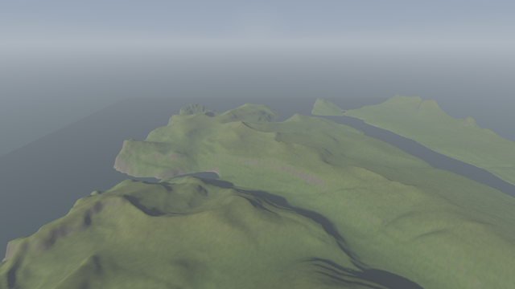
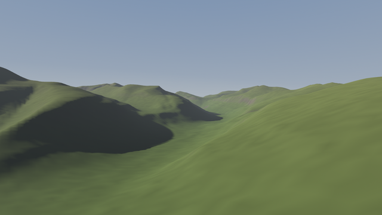
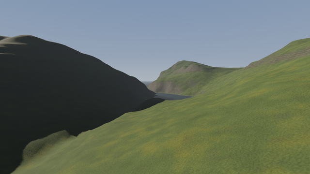
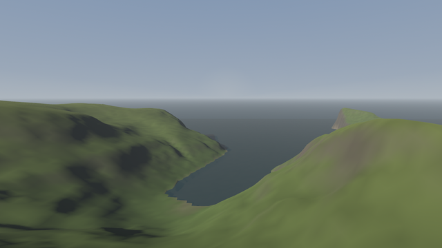

# Discover Earth

A dreamlike island explorer: real islands, real weather and light, and moments where the land melts into a dream.
No goals, only awe. The first island is the Saksun valley and Tjørnuvík on Streymoy, Faroe Islands, built from open elevation data.

It's written in Rust, with **Bevy** drawing the 3D world. Everything an
agent needs is data, a command line, and captures it can look at: see [CLAUDE.md](CLAUDE.md).

| Overview | Down the valley |
| --- | --- |
|  |  |
|  |  |

## Run it

```
cargo run --release -p de_client --bin discover-earth
```

You fly a camera drone the way real ones fly: mode-2 sticks, a stabilised hover when you let go, a level gimbal, and
three flight modes (cine 5 m/s, normal 12 m/s, sport 21 m/s, tuned in `content/drone.json`).

| | Gamepad (mode 2) | Keyboard and mouse |
| --- | --- | --- |
| Climb / descend | left stick up / down | Space / C |
| Turn | left stick left / right | Q / E, or right-drag |
| Forward / back | right stick up / down | W / S |
| Sideways | right stick left / right | A / D |
| Tilt camera | right trigger up, left trigger down | R / F, or right-drag |
| Flight mode | bumpers | 1 cine, 2 normal, 3 sport |

Linux needs `libasound2-dev libudev-dev pkg-config` to build; Windows needs nothing extra. On Windows the game draws with
DirectX 12: after the first build run `python scripts/dxc/fetch.py` once, which puts Microsoft's DXC shader compiler
next to the game. Without it the island can take a minute to appear (the game says which compiler it uses).

## For agents and scripts

```
scripts/check.sh [--shots [--ref <dir>]]          # the whole check; verdict in out/check/summary.json
cargo run -q -p de_cli -- capabilities            # what exists
cargo run -q -p de_cli -- schema terrain|steps|drone   # how content is written
cargo run -q -p de_cli -- validate                # check all content
cargo run -q -p de_client --bin de-shot -- content/shots/smoke.json out/shots   # screenshots, clips, sense.md
cargo run -q -p de_cli -- sweep valley --set look.fog_half_m=4000,12000,30000      # options as one sheet
cargo run -q -p de_cli -- compare <before-dir> <after-dir>                         # FLIP difference per shot
```

## Credits

Image comparison: [NVIDIA FLIP](https://github.com/NVlabs/flip) (BSD-3-Clause) through the `nv-flip` crate.

Windows shader compiler, when downloaded with `scripts/dxc/fetch.py`: [DirectXShaderCompiler](https://github.com/microsoft/DirectXShaderCompiler)
(University of Illinois/NCSA Open Source License and MIT).

Ground materials, when downloaded with `scripts/materials/fetch.py`: [ambientCG](https://ambientcg.com), CC0 1.0.

Elevation: Copernicus DEM GLO-30 © DLR e.V. 2010-2014 and © Airbus Defence and Space GmbH 2014-2018, provided under
COPERNICUS by the European Union and ESA.

## Where this is going

The long-term goal is an LLM-first toolchain for building the game: see [docs/NORTH_STAR.md](docs/NORTH_STAR.md),
[docs/STUDY.md](docs/STUDY.md) and [docs/ROADMAP.md](docs/ROADMAP.md).
